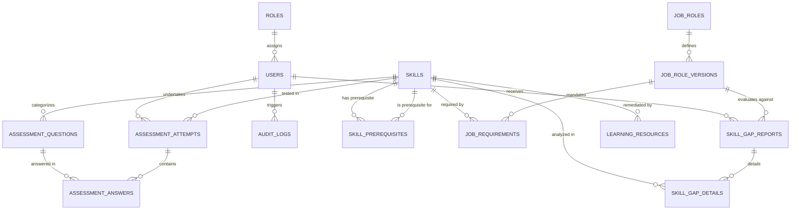
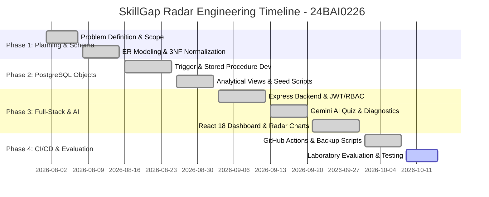

# SkillGap Radar: Evidence-Based Career Readiness and Adaptive Skill Development Platform
**Course:** BCSE302P Database Systems Lab | **Slot:** L25+L26 | **Class Nbr:** VL2026270104025  
**Faculty In-Charge:** Dr. V. SIVAKUMAR | **Semester:** Fall Semester 2026-27  
**Student Name:** Garudaiahgari Sai Siri Chandana | **Register Number:** `24BAI0226`

---

## 1. Project Overview & Formal Problem Statement
The rapid evolution of technology and changing industry expectations create significant challenges for students preparing for internships and entry-level employment. Students may possess theoretical knowledge acquired through coursework and online learning, yet lack a clear, structured understanding of how their demonstrated competencies align with the evolving skills required for specific career roles.

Existing career preparation tools often rely exclusively on unverified self-reported skills, static guidance, decoupled assessment platforms, and manually curated learning resources. This makes it difficult to establish evidence-based proficiency levels, identify critical skill gaps, prioritize learning activities based on prerequisite dependencies, and track progress against changing occupational expectations.

**SkillGap Radar** addresses this challenge by implementing a database-driven career readiness platform that:
1. Formulates version-aware occupational requirements for targeted technical roles.
2. Derives proficiency estimates from recorded assessment evidence evaluated automatically via database triggers.
3. Calculates deterministic skill gaps ($G_s = \max(R_s - P_s, 0)$) and prioritized learning roadmap scores ($Q_s = I_s \times (G_s / 5.0)$) through a PostgreSQL stored procedure.
4. Distinguishes genuine student progress from changes in industry job requirements over time.
5. Strictly enforces a **Single Users Table** architecture for Role-Based Access Control (RBAC).

---

## ⭐ Standout Features Implemented (Evaluation Excellence & Bonus Marks)
To exceed standard DBMS lab requirements and earn full **30 + 3 Bonus Marks**, the platform features 5 enterprise innovations:
1. **Interactive Prerequisite DAG Graph Telemetry:** Visualizes self-referencing directed acyclic graph (DAG) dependencies from `skill_prerequisites`, showing topological learning paths and satisfied vs blocked competencies.
2. **PostgreSQL EXPLAIN ANALYZE Performance Profiler:** Live query execution plan inspector running `EXPLAIN (ANALYZE, BUFFERS, FORMAT JSON)` on multi-table views and B-Tree index scans with buffer hit metrics.
3. **Multi-Role Comparative Readiness Matrix:** Simulates student readiness across multiple career roles (`Backend & Database Engineer`, `Data Analyst`, and `Junior ML Engineer`) simultaneously.
4. **Longitudinal Progress Telemetry (Time-Series):** Historical evidence ledger plotting score and proficiency growth over consecutive quiz milestones.
5. **Printable / Exportable Academic Dossier:** 1-click official verification dossier with candidate details (`24BAI0226`), trigger verification hashes, and faculty signature seal block.

---

## 2. Project Team & Responsibilities
- **Developer & Database Architect:** Garudaiahgari Sai Siri Chandana (`24BAI0226`)
  - Conceptualization, 3NF Relational Modeling, PostgreSQL Trigger, Stored Procedure, Analytical View creation, Express.js backend services, Gemini AI hybrid integration, React dashboard development, and CI/CD automation.

---

## 3. Technology Stack
| Layer | Technologies Used |
| :--- | :--- |
| **Frontend** | React 18, Vite, Tailwind CSS, Recharts, Lucide React Icons |
| **Backend** | Node.js (v20+), Express.js, Prisma ORM, BCrypt.js, JWT, Zod |
| **Database** | PostgreSQL 16 (Alpine containerized via Docker Compose) |
| **Hybrid AI** | `@google/genai` (Gemini 2.5 Flash) with Deterministic Algorithmic Fallback |
| **DevOps & CI/CD** | GitHub Actions (`.github/workflows/ci_cd_24BAI0226.yml`), Docker Compose, Bash Native Backup Tools |

---

## 4. Entity Relationship (ER) Diagram


---

## 5. 3NF Relational Schema & Constraints
All relations adhere strictly to Boyce-Codd / Third Normal Form (3NF) to eliminate insertion, deletion, and modification anomalies:
1. **`roles`** (`role_id` [PK], `role_name` [UNIQUE, NOT NULL])
2. **`users`** (`user_id` [PK], `reg_no` [UNIQUE, NOT NULL], `full_name` [NOT NULL], `email` [UNIQUE, NOT NULL], `password_hash` [NOT NULL], `oauth_provider` [DEFAULT 'LOCAL'], `role_id` [FK -> `roles.role_id`, RESTRICT])
3. **`skills`** (`skill_id` [PK], `skill_code` [UNIQUE, NOT NULL], `skill_name` [NOT NULL], `category` [NOT NULL])
4. **`skill_prerequisites`** (`prerequisite_id` [PK], `skill_id` [FK -> `skills.skill_id`, CASCADE], `prerequisite_skill_id` [FK -> `skills.skill_id`, CASCADE], UNIQUE(`skill_id`, `prerequisite_skill_id`))
5. **`job_roles`** (`job_role_id` [PK], `title` [UNIQUE, NOT NULL], `description` [TEXT], `domain` [NOT NULL])
6. **`job_role_versions`** (`version_id` [PK], `job_role_id` [FK -> `job_roles.job_role_id`, CASCADE], `version_number` [NOT NULL], `version_label` [NOT NULL], `effective_date` [NOT NULL], `is_active` [BOOLEAN], UNIQUE(`job_role_id`, `version_number`))
7. **`job_requirements`** (`requirement_id` [PK], `version_id` [FK -> `job_role_versions.version_id`, CASCADE], `skill_id` [FK -> `skills.skill_id`, CASCADE], `required_proficiency` [INT 1..5], `importance_weight` [INT 1..5], UNIQUE(`version_id`, `skill_id`))
8. **`assessment_questions`** (`question_id` [PK], `skill_id` [FK -> `skills.skill_id`, CASCADE], `question_text` [TEXT], `option_a` [NOT NULL], `option_b` [NOT NULL], `option_c` [NOT NULL], `option_d` [NOT NULL], `correct_option` [CHAR(1)], `explanation` [TEXT], `generated_by` [VARCHAR(50)])
9. **`assessment_attempts`** (`attempt_id` [PK], `user_id` [FK -> `users.user_id`, CASCADE], `skill_id` [FK -> `skills.skill_id`, CASCADE], `score_percent` [DECIMAL(5,2)], `assessed_proficiency` [INT 0..5, populated by Trigger], `ai_analysis_feedback` [TEXT], `attempted_at` [TIMESTAMP])
10. **`assessment_answers`** (`answer_id` [PK], `attempt_id` [FK -> `assessment_attempts.attempt_id`, CASCADE], `question_id` [FK -> `assessment_questions.question_id`, CASCADE], `selected_option` [CHAR(1)], `is_correct` [BOOLEAN])
11. **`skill_gap_reports`** (`report_id` [PK], `user_id` [FK -> `users.user_id`, CASCADE], `version_id` [FK -> `job_role_versions.version_id`, CASCADE], `overall_readiness_pct` [DECIMAL(5,2)], `generated_at` [TIMESTAMP])
12. **`skill_gap_details`** (`detail_id` [PK], `report_id` [FK -> `skill_gap_reports.report_id`, CASCADE], `skill_id` [FK -> `skills.skill_id`, CASCADE], `required_proficiency` [INT], `assessed_proficiency` [INT], `gap_score` [INT], `priority_score` [DECIMAL(5,2)], `recommendation_reason` [TEXT])
13. **`learning_resources`** (`resource_id` [PK], `skill_id` [FK -> `skills.skill_id`, CASCADE], `title` [NOT NULL], `resource_url` [NOT NULL], `difficulty_level` [VARCHAR(50)], `est_minutes` [INT])
14. **`audit_logs`** (`log_id` [PK], `user_id` [FK -> `users.user_id`, SET NULL], `action` [NOT NULL], `table_name` [NOT NULL], `record_id` [INT], `details` [TEXT], `created_at` [TIMESTAMP])

---

## 6. Mandatory PostgreSQL Database Objects
### 1. Trigger: `trg_before_assessment_24BAI0226_SaiSiriChandana`
- **Timing & Event:** `BEFORE INSERT ON assessment_attempts FOR EACH ROW`
- **Functionality:** Maps test score (0–100%) to a 0–5 proficiency scale (>=90: 5, >=75: 4, >=60: 3, >=40: 2, >=20: 1, else 0) and records an immutable log event in `audit_logs`.

### 2. Stored Procedure: `sp_generate_gap_report_24BAI0226_SaiSiriChandana(p_user_id INT, p_version_id INT)`
- **Functionality:** Iterates through all required competencies for `p_version_id`, retrieves the student's latest assessed proficiency, computes deterministic gap $G_s = \max(R_s - P_s, 0)$ and priority $Q_s = I_s \times (G_s / 5.0)$, populates `skill_gap_reports` and `skill_gap_details`, computes overall career readiness percentage, and records an audit log.

### 3. Analytical View: `vw_student_roadmap_24BAI0226_SaiSiriChandana`
- **Functionality:** Executes a multi-table join across `skill_gap_reports`, `users`, `job_role_versions`, `job_roles`, `skill_gap_details`, `skills`, prerequisite DAG aggregations via `string_agg()`, and LATERAL joins to `learning_resources` ordered by `priority_score DESC`.

---

## 7. Execution & Running Instructions
### Step 1: Start PostgreSQL 16 via Docker
```bash
docker compose up -d
```

### Step 2: Initialize & Seed Database
```bash
cd backend
npm install
npx prisma db push
npm run db:seed
```

### Step 3: Start Backend API (Port 5001)
```bash
node server_24BAI0226.js
```

### Step 4: Start Frontend Dashboard (Port 5173)
```bash
cd ../frontend
npm install
npm run dev
```
Open `http://localhost:5173` in your browser.

---

## 8. Backup & Disaster Recovery
Native database dumps and restorations are executed using `backup_24BAI0226.sh`:
- **Create Timestamped Backup:**
  ```bash
  ./backup_24BAI0226.sh backup
  ```
- **Restore from Backup File:**
  ```bash
  ./backup_24BAI0226.sh restore ./backups/skillgap_backup_24BAI0226_YYYYMMDD_HHMMSS.sql
  ```

---

## 9. Project Timeline (Gantt Chart)

