# Entity-Relationship (ER) Diagram: SkillGap Radar

**Student:** Garudaiahgari Sai Siri Chandana | **Register Number:** `24BAI0226`  
**Course:** BCSE302P Database Systems Lab | **Slot:** `L25+L26` | **Faculty:** Dr. V. SIVAKUMAR  

---

## 1. Complete Mermaid ER Diagram

```mermaid
erDiagram
    ROLES ||--o{ USERS : "assigned_to"
    USERS ||--o{ ASSESSMENT_ATTEMPTS : "takes"
    USERS ||--o{ SKILL_GAP_REPORTS : "receives"
    USERS ||--o{ LEARNING_PROGRESS : "tracks"
    USERS ||--o{ SIMULATION_SCENARIOS : "creates"
    USERS ||--o{ NOTIFICATIONS : "receives"
    USERS ||--o{ AUDIT_LOGS : "triggers"

    SKILLS ||--o{ JOB_REQUIREMENTS : "required_in"
    SKILLS ||--o{ SKILL_PREREQUISITES : "has_prerequisite"
    SKILLS ||--o{ ASSESSMENT_QUESTIONS : "categorized_by"
    SKILLS ||--o{ ASSESSMENT_ATTEMPTS : "evaluated_in"
    SKILLS ||--o{ LEARNING_RESOURCES : "associated_with"
    SKILLS ||--o{ SKILL_GAP_DETAILS : "detailed_in"
    SKILLS ||--o{ SIMULATION_SKILL_CHANGES : "simulated_in"

    JOB_ROLES ||--o{ JOB_ROLE_VERSIONS : "versioned_as"
    JOB_ROLE_VERSIONS ||--o{ JOB_REQUIREMENTS : "contains"
    JOB_ROLE_VERSIONS ||--o{ SKILL_GAP_REPORTS : "evaluates_against"
    JOB_ROLE_VERSIONS ||--o{ SIMULATION_SCENARIOS : "targets"

    ASSESSMENT_ATTEMPTS ||--o{ ASSESSMENT_ANSWERS : "contains"
    ASSESSMENT_QUESTIONS ||--o{ ASSESSMENT_ANSWERS : "answered_in"

    LEARNING_RESOURCES ||--o{ LEARNING_PROGRESS : "completed_in"

    SKILL_GAP_REPORTS ||--o{ SKILL_GAP_DETAILS : "itemized_in"

    SIMULATION_SCENARIOS ||--o{ SIMULATION_SKILL_CHANGES : "records_delta"

    ROLES {
        int role_id PK
        string role_name UK
    }

    USERS {
        int user_id PK
        int role_id FK
        string full_name
        string email UK
        string reg_no UK
        string password_hash
        timestamp created_at
    }

    SKILLS {
        int skill_id PK
        string skill_name UK
        string skill_code UK
        string category
        text description
    }

    JOB_ROLES {
        int job_role_id PK
        string title UK
        text description
        string domain
    }

    JOB_ROLE_VERSIONS {
        int version_id PK
        int job_role_id FK
        string version_number
        string version_label
        timestamp effective_date
        boolean is_active
    }

    JOB_REQUIREMENTS {
        int requirement_id PK
        int version_id FK
        int skill_id FK
        int required_proficiency
        int importance_weight
    }

    SKILL_PREREQUISITES {
        int prerequisite_id PK
        int skill_id FK
        int prerequisite_skill_id FK
        string relationship_type
    }

    ASSESSMENT_QUESTIONS {
        int question_id PK
        int skill_id FK
        text question_text
        string option_a
        string option_b
        string option_c
        string option_d
        string correct_option
        text explanation
        string difficulty
        string generated_by
    }

    ASSESSMENT_ATTEMPTS {
        int attempt_id PK
        int user_id FK
        int skill_id FK
        numeric score_percent
        int assessed_proficiency
        int correct_count
        int total_count
        text ai_diagnostic_feedback
        timestamp attempted_at
    }

    ASSESSMENT_ANSWERS {
        int answer_id PK
        int attempt_id FK
        int question_id FK
        string selected_option
        boolean is_correct
    }

    LEARNING_RESOURCES {
        int resource_id PK
        int skill_id FK
        string title
        text description
        string resource_url
        string resource_type
        string difficulty_level
        int est_minutes
        boolean is_active
    }

    LEARNING_PROGRESS {
        int progress_id PK
        int user_id FK
        int resource_id FK
        string status
        timestamp completed_at
    }

    SKILL_GAP_REPORTS {
        int report_id PK
        int user_id FK
        int version_id FK
        numeric overall_readiness_pct
        timestamp generated_at
    }

    SKILL_GAP_DETAILS {
        int detail_id PK
        int report_id FK
        int skill_id FK
        int required_proficiency
        int assessed_proficiency
        int gap_score
        numeric priority_score
        text recommendation_reason
    }

    SIMULATION_SCENARIOS {
        int scenario_id PK
        int user_id FK
        int version_id FK
        string scenario_name
        numeric baseline_readiness_pct
        numeric simulated_readiness_pct
        int gap_reduction_points
        timestamp created_at
    }

    SIMULATION_SKILL_CHANGES {
        int change_id PK
        int scenario_id FK
        int skill_id FK
        int baseline_proficiency
        int simulated_proficiency
    }

    NOTIFICATIONS {
        int notification_id PK
        int user_id FK
        string title
        text message
        string type
        boolean is_read
        timestamp created_at
    }

    AUDIT_LOGS {
        int log_id PK
        int user_id FK
        string action
        string table_name
        int record_id
        text details
        timestamp created_at
    }
```

