# Entity-Relationship (ER) Diagram: WanderBudget AI

**Course:** BCSE302P Database Systems Lab  
`24BAI0226`  
**Slot:** L25+L26 | **Faculty In-Charge:** Faculty In-Charge  

---

## 1. ER Diagram Specification & Rubric Compliance
* **Minimum Primary Entities Required:** 4 $\rightarrow$ **Implemented: 11 Entities**
* **Minimum Relationships Required:** 3 $\rightarrow$ **Implemented: 12+ Relationships**
* **Minimum Tables Required:** 8 $\rightarrow$ **Implemented: 11 Relational Tables**
* **Single Users Table Constraint:** Satisfied (`users` table with `role` column separating `TRAVELER` and `ADMIN`).

---

## 2. Complete Entity-Relationship (ER) Diagram (Mermaid)

```mermaid
erDiagram
    users ||--o{ trips : "creates (1:N)"
    users ||--o{ trip_expenses : "logs (1:N)"
    users ||--o{ audit_logs : "initiates (1:N)"
    
    destinations ||--|| cost_of_living_indices : "indexes (1:1)"
    destinations ||--o{ attractions : "features (1:N)"
    destinations ||--o{ trips : "hosts (1:N)"
    
    trips ||--o{ trip_places : "contains (1:N)"
    trips ||--o{ trip_budget_breakdowns : "allocates (1:N)"
    trips ||--o{ trip_expenses : "incurs (1:N)"
    trips ||--o{ budget_alerts : "triggers (1:N)"
    
    attractions ||--o{ trip_places : "scheduled_in (1:N)"
    
    budget_categories ||--o{ trip_budget_breakdowns : "categorizes (1:N)"
    budget_categories ||--o{ trip_expenses : "classifies (1:N)"
    budget_categories ||--o{ budget_alerts : "flags (1:N)"

    users {
        int user_id PK "Auto Increment"
        string reg_no UK "Student / Admin Identifier"
        string full_name "User Full Name"
        string email UK "Unique Email Address"
        string password_hash "Bcrypt Hash (10 Salt Rounds)"
        string role "TRAVELER | ADMIN"
        string home_currency "Default: INR"
        string oauth_provider "LOCAL | GOOGLE"
        datetime created_at "Timestamp"
    }

    destinations {
        int destination_id PK "Auto Increment"
        string city_name "City Name"
        string country_name "Country Name"
        string currency_code "e.g., JPY, EUR, USD"
        string currency_symbol "e.g., ¥, €, $"
        text description "Overview"
        string image_url "Destination Photo"
        datetime created_at "Timestamp"
        datetime updated_at "Timestamp"
    }

    cost_of_living_indices {
        int cost_index_id PK "Auto Increment"
        int destination_id FK,UK "1:1 with destinations"
        decimal accommodation_budget_night "Hostels/Dorms"
        decimal accommodation_standard_night "3-Star Hotels"
        decimal accommodation_luxury_night "5-Star Resorts"
        decimal meal_budget_day "Street/Local Food"
        decimal meal_standard_day "Casual Dining"
        decimal meal_luxury_day "Fine Dining"
        decimal transit_pass_day "Daily Pass"
        decimal taxi_per_km "Cab Rate / Km"
        decimal exchange_rate_to_inr "Rate to 1 Local Unit"
        string source "Live Web Search / Benchmark"
        decimal confidence_score "0.0 - 1.0"
        datetime last_synced_at "Timestamp"
    }

    attractions {
        int attraction_id PK "Auto Increment"
        int destination_id FK "References destinations"
        string name "Attraction Name"
        string category "Historical | Nature | Culture | Adventure"
        decimal ticket_price_local "Local Currency"
        decimal ticket_price_inr "Normalized to INR"
        decimal avg_duration_hours "Time to Visit"
        string recommended_style "BUDGET | STANDARD | LUXURY | ALL"
        string image_url "Photo Link"
        text description "Details"
    }

    trips {
        int trip_id PK "Auto Increment"
        int user_id FK "References users"
        int destination_id FK "References destinations"
        string title "Trip Title"
        date start_date "Start Date"
        date end_date "End Date"
        int duration_days "Length of Stay"
        string travel_style "BUDGET | STANDARD | LUXURY"
        int group_size "Number of Travelers"
        decimal total_budget_inr "Allocated Trip Budget"
        decimal total_spent_inr "Aggregate Spending"
        string status "PLANNING | ACTIVE | COMPLETED"
        datetime created_at "Timestamp"
        datetime updated_at "Timestamp"
    }

    trip_places {
        int trip_place_id PK "Auto Increment"
        int trip_id FK "References trips"
        int attraction_id FK "References attractions"
        int planned_day "Day 1, 2, 3..."
        decimal estimated_cost_inr "Admission/Activity Cost"
        text notes "User Notes"
    }

    budget_categories {
        int category_id PK "Auto Increment"
        string category_code UK "ACCOMMODATION | FOOD | SIGHTSEEING | TRANSIT | BUFFER"
        string category_name "Display Name"
        string icon "Lucide Icon Identifier"
    }

    trip_budget_breakdowns {
        int breakdown_id PK "Auto Increment"
        int trip_id FK "References trips"
        int category_id FK "References budget_categories"
        decimal allocated_amount_inr "Category Budget"
        decimal spent_amount_inr "Category Spent"
    }

    trip_expenses {
        int expense_id PK "Auto Increment"
        int trip_id FK "References trips"
        int category_id FK "References budget_categories"
        int user_id FK "References users"
        string expense_name "Item or Service Title"
        decimal amount_inr "Converted Amount (INR)"
        string currency_code "Currency at Purchase"
        decimal amount_original "Original Amount"
        datetime expense_date "Expense Timestamp"
        string payment_method "CARD | CASH | UPI | FOREX"
        string receipt_url "Receipt Proof"
        text notes "User Remarks"
        datetime created_at "Timestamp"
    }

    budget_alerts {
        int alert_id PK "Auto Increment"
        int trip_id FK "References trips"
        int category_id FK "References budget_categories (Nullable)"
        string alert_type "WARNING_80_PERCENT | CRITICAL_100_PERCENT | BUDGET_EXCEEDED"
        text message "Trigger Generated Message"
        decimal threshold_pct "Overrun Percentage"
        boolean is_resolved "Status Flag"
        datetime created_at "Timestamp"
    }

    audit_logs {
        int log_id PK "Auto Increment"
        int user_id FK "References users (Nullable)"
        string action "LOGIN | CREATE_TRIP | LOG_EXPENSE | etc."
        string entity_type "Entity Modified"
        int entity_id "Entity ID"
        string ip_address "Client IP"
        text details "JSON / Text Summary"
        datetime timestamp "Timestamp"
    }
```

---

## 3. Entity Cardinality & Participation Analysis

1. **`users` to `trips` (1 : N)**: One user can create zero or many trips. Every trip must belong to exactly one user.
2. **`destinations` to `cost_of_living_indices` (1 : 1)**: Each destination has exactly one cost-of-living benchmark record.
3. **`destinations` to `attractions` (1 : N)**: A destination hosts many sightseeing attractions.
4. **`destinations` to `trips` (1 : N)**: A destination hosts multiple traveler trips.
5. **`trips` to `trip_places` (1 : N) and `attractions` to `trip_places` (1 : N)**: Resolves the M:N relationship between `trips` and `attractions` (associative entity).
6. **`trips` to `trip_budget_breakdowns` (1 : N) and `budget_categories` to `trip_budget_breakdowns` (1 : N)**: Resolves the M:N relationship between `trips` and `budget_categories` with specific financial allocation.
7. **`trips` to `trip_expenses` (1 : N)**: Every expense belongs to a specific trip and is categorized by `budget_categories`.
8. **`trips` to `budget_alerts` (1 : N)**: Triggered dynamically when category or trip spending crosses 80% or 100% of budget.
9. **`users` to `audit_logs` (1 : N)**: Captures user actions for non-repudiation and security forensics.
