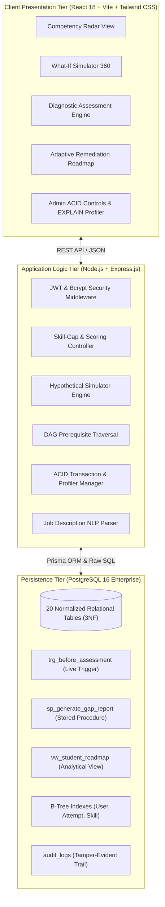

# Project Overview: SkillGap Radar

**Project Title:** SkillGap Radar — Evidence-Based Career Readiness, Adaptive Learning, and What-If Career Simulation Platform  
**Course:** BCSE302P Database Systems Lab (Assessment 8, 9 & 10)  
**Student:** Garudaiahgari Sai Siri Chandana | **Register Number:** `24BAI0226`  
**Slot:** `L25+L26` | **Faculty In-Charge:** Dr. V. SIVAKUMAR  
**Institution:** School of Computer Science and Engineering (SCOPE), VIT Chennai  
**Academic Year:** Fall Semester 2026–27  

---

## 1. Executive Summary
**SkillGap Radar** is a production-grade, full-stack database application engineered to provide college students, recent graduates, and academic mentors with evidence-based career readiness intelligence. In standard career platforms, skill recommendations are either static or rely on self-reported proficiencies that lack verifiable assessment evidence. SkillGap Radar bridges this gap by marrying relational database integrity with dynamic competency diagnostics.

The core platform features:
1. **Evidence-Based Skill Assessments**: Dynamic, domain-calibrated assessments whose scores are automatically evaluated and mapped to discrete proficiency levels (1–5) via an active PostgreSQL trigger (`trg_before_assessment_24BAI0226_SaiSiriChandana`).
2. **Deterministic Priority-Weighted Gap Analysis**: An automated stored procedure (`sp_generate_gap_report_24BAI0226_SaiSiriChandana`) calculates competency gaps $G_s = \max(R_s - A_s, 0)$ and prioritized action scores $Q_s = W_s \times (G_s / 5.0)$ with zero AI hallucination.
3. **Adaptive Learning Roadmaps**: Real-time analytical view (`vw_student_roadmap_24BAI0226_SaiSiriChandana`) linking unresolved gaps directly to curated learning resources with estimated completion durations and prerequisite enforcement.
4. **Prerequisite DAG Graph**: Directed acyclic graph tracking transitive dependencies between foundational and advanced competencies to prevent cognitive overload.
5. **SkillGap Radar 360 (What-If Career Simulator)**: An isolated hypothetical sandbox where students simulate proficiency adjustments and observe readiness trajectories and multi-career spillover across adjacent roles without altering actual assessment evidence.
6. **AI-Assisted Job Description Analysis & Version Publishing**: Administrative NLP parsing module with deterministic fallback that parses unstructured job descriptions, matches candidate skills to the canonical catalogue, and publishes new requirement versions with human approval.
7. **ACID Transactions & Automated Audit Trails**: Multi-table atomic mutations and continuous telemetry logging into PostgreSQL `audit_logs` for compliance and forensic inspection.

---

## 2. Target Audience & Stakeholders
- **Students & Career Seekers**: Gain objective clarity on career deficiencies, track historical progress milestones, and explore alternative career simulations.
- **Academic Mentors & Faculty**: Monitor laboratory assessment validity, inspect SQL performance benchmarks, and evaluate student mastery.
- **Corporate Recruiters & Hiring Managers**: Review verifiable academic dossiers with SHA-256 integrity digests rather than unverified resumes.

---

## 3. High-Level System Architecture

