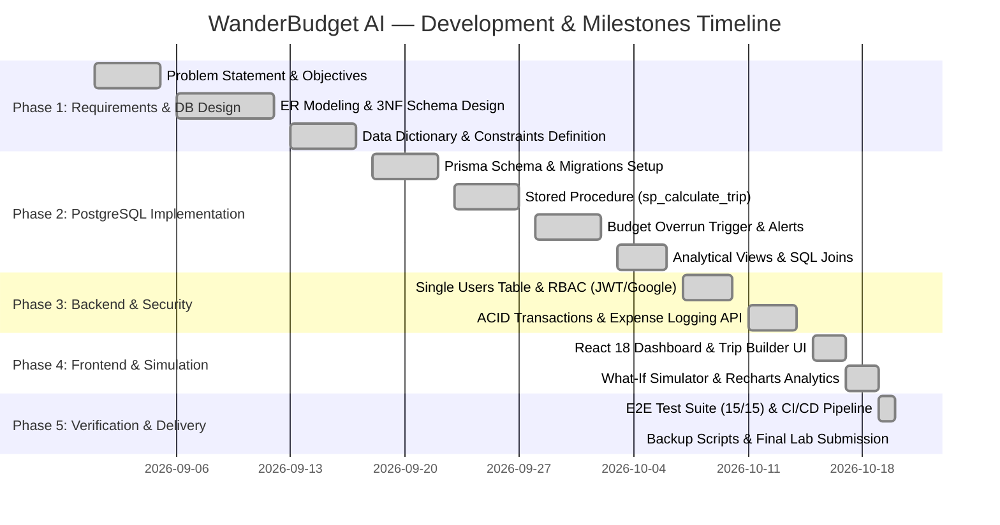

# Project Planning & Proposal: WanderBudget AI

**Course:** BCSE302P Database Systems Lab  
**Student:** Garudaiahgari Sai Siri Chandana | **Register Number:** `24BAI0226`  
**Slot:** L25+L26 | **Faculty In-Charge:** Dr. V. SIVAKUMAR  
**Academic Year:** Fall Semester 2026–27  

---

## 1. Project Title
**WanderBudget AI — Dynamic Trip Budget Builder & Live AI Cost-of-Living Analyzer**

---

## 2. Problem Statement
Modern leisure and student travelers face significant financial unpredictability when planning domestic and international trips. Commercial tourism engines (e.g., MakeMyTrip, Expedia, Booking.com) exclusively focus on flight and hotel bookings, neglecting the daily ground realities of travel economics:
1. **Absence of Unified Ground Cost Modeling**: Travelers lack accurate estimates for dining, local transit, attraction admissions, and contingency buffers tailored to specific travel styles (Budget, Standard, Luxury).
2. **Static & Stale Data**: Traditional guidebooks and static cost blogs fail to account for real-time currency fluctuations and post-inflation pricing.
3. **Budget Overrun Risks**: Travelers routinely exceed budgets during trips due to an absence of automated threshold triggers and category-wise variance monitoring.
4. **Disjointed Itinerary & Financial Planning**: Itinerary generation is disconnected from real-time database transactions, leading to surprise expenses.

**WanderBudget AI** bridges this gap by providing an end-to-end relational database system that couples live web-grounded destination economics with deterministic PostgreSQL calculations, stored procedures, automated overrun triggers, and what-if simulation modeling.

---

## 3. Objectives
1. **Relational Database Design**: Architect a normalized 3NF/BCNF relational database schema comprising 11 related tables with strict referential integrity, check constraints, and B-Tree indexes.
2. **Automated Budget Engine**: Implement a PostgreSQL stored procedure (`sp_calculate_trip_budget`) to compute itemized budgets based on travel duration, party size, travel style, and attraction admissions.
3. **Real-Time Overrun Prevention**: Construct native database triggers (`trg_check_budget_overrun`) that automatically detect budget overruns and log warning (`WARNING_80_PERCENT`) and critical (`BUDGET_EXCEEDED`) alerts into a dedicated alert ledger.
4. **Analytical Views**: Create multi-table analytical views (`v_trip_budget_summary`, `v_trip_category_variance`, `v_destination_cost_overview`) for immediate dashboard visualization.
5. **Secure Authentication & Single Users RBAC**: Implement secure JWT and Google OAuth 2.0 authentication enforcing strict Role-Based Access Control (`TRAVELER` vs `ADMIN`) within a **single `users` table**.
6. **What-If Financial Simulation**: Deliver an interactive client interface allowing travelers to simulate duration and travel-style alterations with instant mathematical variance.

---

## 4. Scope
### In Scope:
* Global destination repository spanning Europe, Asia, Americas, Middle East, Oceania, and India.
* Dynamic cost-of-living index per destination (budget, standard, luxury accommodation; meals; local transit; taxi per km; real-time foreign exchange to INR).
* Full CRUD operations on destinations, attractions, trips, itinerary places, and actual expenses.
* Deterministic ACID transactions (`prisma.$transaction`) for trip generation and budget breakdown initialization.
* Native backup and recovery pipeline using `pg_dump` and `pg_restore`.
* Automated end-to-end verification test suite and CI/CD pipeline via GitHub Actions.

### Out of Scope:
* Direct payment gateway settlements (actual credit card debit processing).
* Flight ticket airline reservation GDS integrations.

---

## 5. Team Members and Responsibilities
| Team Member | Register Number | Role & Responsibilities |
| :--- | :--- | :--- |
| **Garudaiahgari Sai Siri Chandana** | **`24BAI0226`** | **Lead Database Architect & Full-Stack Developer** • ER Diagram & Relational Schema Modeling (3NF/BCNF) • PostgreSQL Stored Procedures, Functions & Triggers (`sp_calculate_trip_budget`, `trg_check_budget_overrun`) • Prisma ORM Integration & ACID Transactions • Express.js REST API Architecture & Single Users Table RBAC • React 18 Dynamic What-If Simulation & Budget Visualizations • Database Backup Automation & GitHub CI/CD Pipeline |

---

## 6. Technology Stack
* **Database Management System:** PostgreSQL 16 (Relational Database Management System)
* **Object Relational Mapping (ORM):** Prisma ORM v5.22
* **Backend Framework:** Node.js 20.x, Express.js 4.21
* **Frontend Framework:** React 18, Vite 6, Tailwind CSS 3.4
* **Data Visualization:** Recharts 2.15 (Interactive Donut & Bar Charts)
* **Authentication & Cryptography:** JSON Web Tokens (JWT), Google OAuth 2.0, bcryptjs (10 salt rounds)
* **Testing & Quality Assurance:** Custom Node.js E2E Automated Verification Test Suite (15/15 tests)
* **DevOps & Tooling:** Docker, Docker Compose, GitHub Actions, native `pg_dump` / `psql`

---

## 7. Major Deliverables
1. **Relational Database Schema & Migrations**: 11 normalized tables in PostgreSQL.
2. **SQL Features Script**: Stored procedure, trigger, and analytical views in `wanderbudget_db_features_24BAI0226.sql`.
3. **Full-Stack Application**: React frontend client and Express.js REST API.
4. **Native Backup & Restore Script**: Executable shell script (`backup_24BAI0226.sh`).
5. **Automated Test Suite**: 15 end-to-end automated tests verifying API & DB state (`test_wanderbudget_24BAI0226.js`).
6. **Comprehensive Documentation**: ER Diagram, Relational Schema, Data Dictionary, Normalization Proof, and Security Architecture.

---

## 8. Project Timeline (Gantt Chart)

